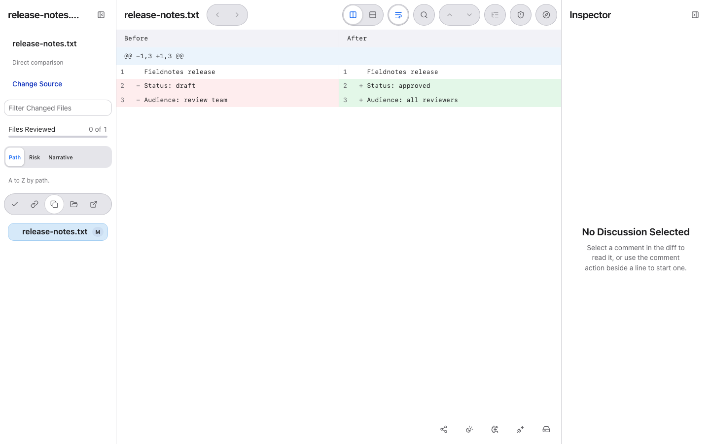
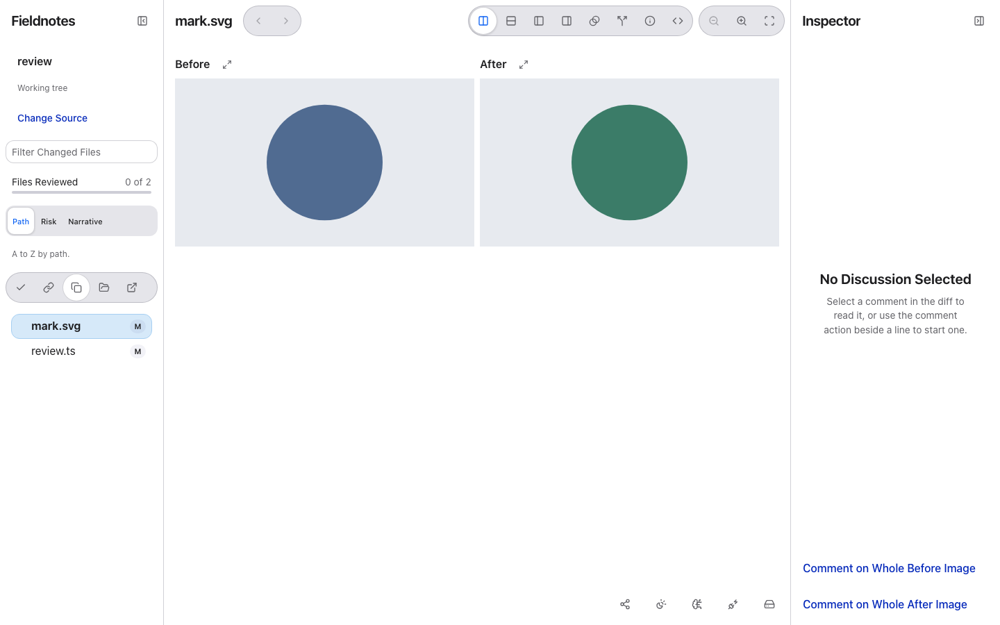
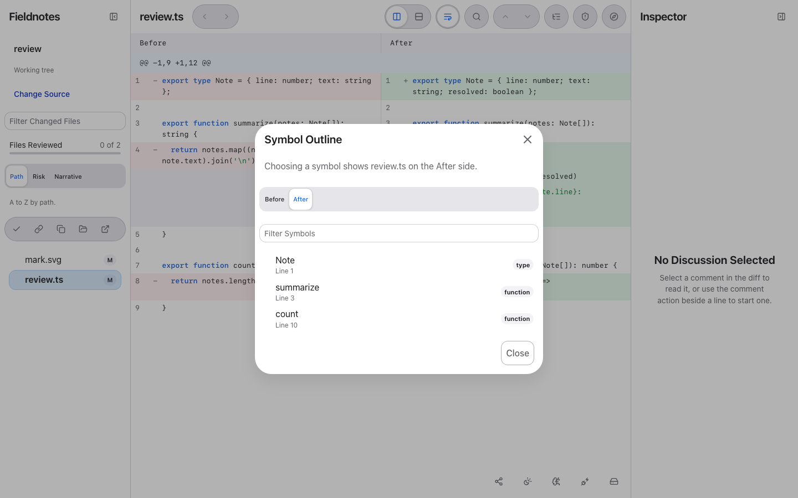
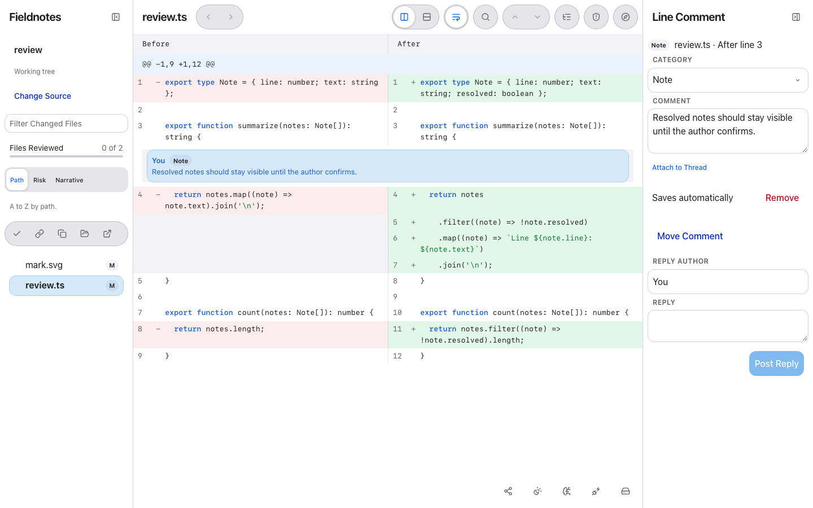
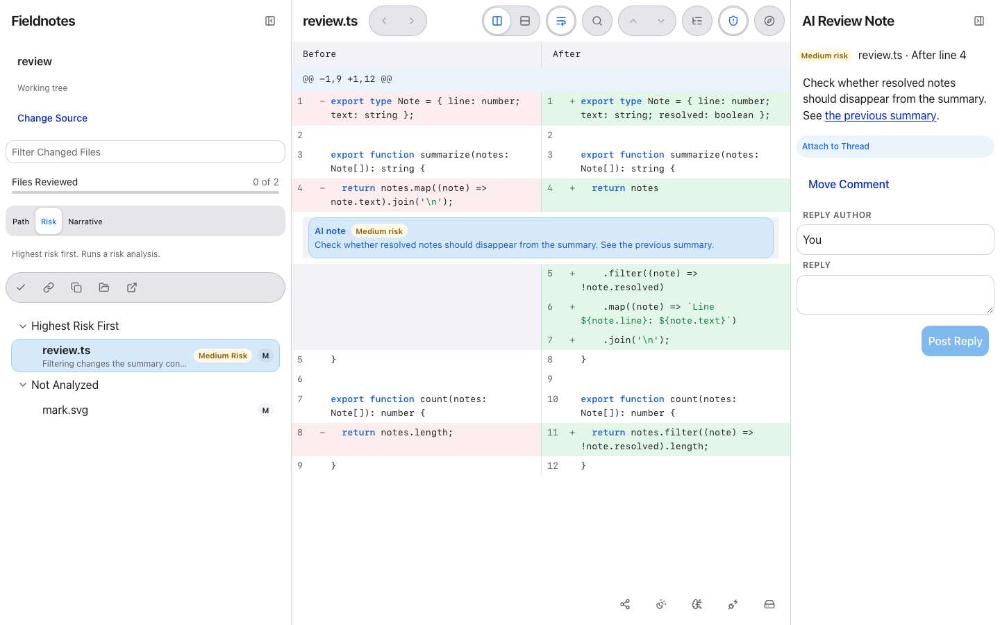
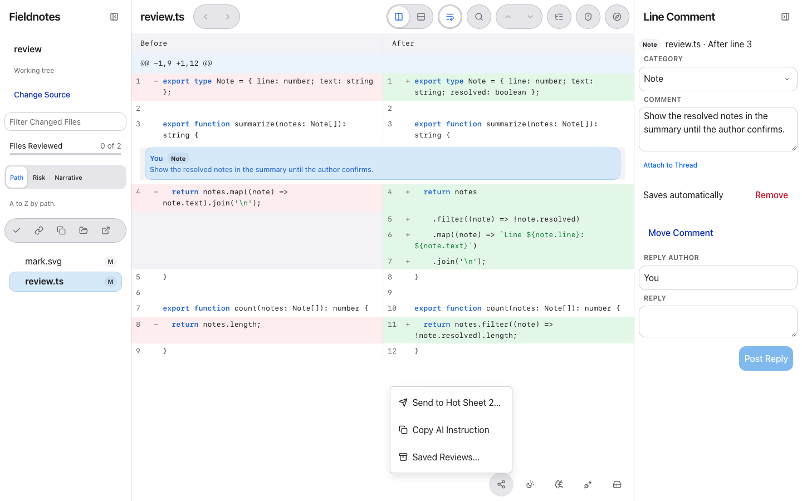

# Glassbox v2

Review Git changes or compare files and folders directly. Discuss individual changes,
follow cited source, and share the review as a feedback bundle.

## Review features

### Compare two files

Open a pair of files without a Git repository.

### Compare images

Inspect the original and revised images side by side.

### Navigate a change

Use the symbol outline to jump to a declaration on either side of the diff.

### Discuss a line

Anchor comments to the line under review and continue the discussion in the inspector.

### Review with AI

Order files by risk and follow a note’s cited commit to see the earlier source.

### Share feedback

Copy an instruction for an AI tool, send the review to Hot Sheet 2, or return to saved reviews.

## Development

The shared Rust core lives in `crates/`. The browser client and its Tauri
wrapper live in `clients/web/`.

From the repository root, run `npm --prefix clients/web ci` to install tooling
and `npm --prefix clients/web run check` to verify the client. Start Vite with
`npm --prefix clients/web run dev` and open `/ux-demo` for the component
catalog. See the [UI conventions](clients/web/docs/ui-conventions.md) for Kerf guidance.

## Web coding conventions

Use the Hot Sheet 2 web client as the reference for Glassbox TypeScript and Kerf
code. Run `npm run lint` and `npm run typecheck` from `clients/web`. Use strict typed ESLint,
sorted imports with type-only imports where applicable, Prettier for formatting,
and Kerf's composition rules. Use public Kerf controls, Lucide icons, accessible
names for icon-only actions, and the Workbench's responsive toolbar layout.

## Architecture and verification

- [Shared core, readiness API, and v1 parity](docs/core.md)
- [Web and Tauri host](docs/hosting.md)
- [Application settings](docs/settings.md)
- [Direct file and folder comparisons](docs/direct-comparison.md)
- [Git review inputs](docs/git-review.md)
- [Symbol navigation](docs/symbol-navigation.md)
- [Text and media comparison content](docs/comparison-content.md)
- [Diagram renderer plugins](docs/content-plugins.md)
- [Review feedback](docs/feedback.md)
- [Glassbox v1 workflow parity](docs/v1-workflow-parity.md)
- [Glassbox v1 carry-forward audit](docs/v1-gap-audit.md)
- [Deterministic demo capture](docs/demo-capture.md)
- [macOS and Linux release verification](docs/release-verification.md)
- [Codebase map](docs/ai/codebase-map.md)
- [Requirements summary](docs/ai/requirements-summary.md)

Run `cargo test --locked --workspace --quiet` for Rust unit and real-service
checks. GitHub Actions runs Rust formatting, Clippy and tests alongside the
web gate.
